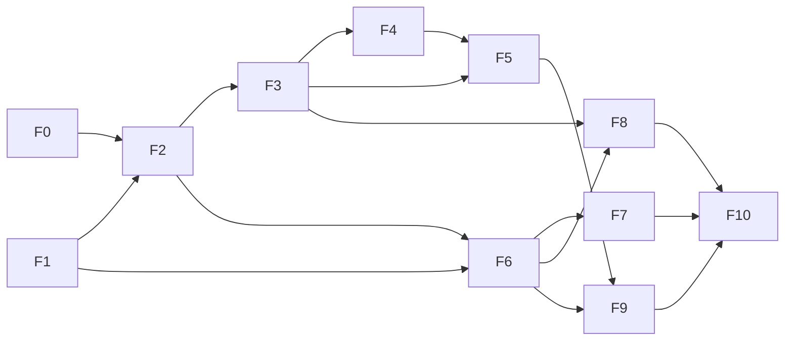

# Interaktív kalandjáték (digitális lapozgatós könyv) – Fejlesztési terv

> Módszertan: **spec-driven + test-driven**. Minden feladat sorrendje: (1) spec/elfogadási kritérium → (2) bukó teszt (RED) → (3) minimális implementáció (GREEN) → (4) refaktor. Feladat csak akkor kész, ha a tesztjei zöldek.

## 0. Rögzített döntések (a felhasználóval egyeztetve)

| Téma              | Döntés                                                                                                 |
| ----------------- | ------------------------------------------------------------------------------------------------------ |
| Stack             | TypeScript + React, böngészős játék                                                                    |
| Történetgráf      | JSON                                                                                                   |
| Játékmotor        | Determinisztikus (seedelhető RNG, tiszta függvények)                                                   |
| Próbarendszer     | Klasszikus kalandkönyv-stílus: **2d6 ≤ tulajdonság** → siker                                           |
| Karakterlap       | Életerő + 3 tulajdonság + Szerencse                                                                    |
| Tartalom nyelve   | Magyar                                                                                                 |
| Mentés            | localStorage, **több mentési slot**                                                                    |
| Vizuális tartalom | Csomópontonként statikus, AI-generált illusztráció                                                     |
| AI az MVP-ben     | Eredeti jelenetek/párbeszédek tervezése, konzisztenciaellenőrzés, képek/hangulat, tesztjátékos-agentek |
| Tesztelés         | Vitest + React Testing Library + Playwright (e2e)                                                      |
| Első szállítandó  | Közvetlenül az MVP; az 5 perces prototípus mérföldkő benne                                             |
| Téma/világ        | **Még nyitott** → külön világ- és történettervezési fázis (Fázis 1)                                    |

### MVP sikerfeltételei (az igényből)

- 15–20 történeti csomópont, több érdemi döntés, elágazó útvonalak
- Legalább 3 különböző befejezés
- 2d6 dobókockás próbák, tárgylista, karakterlap
- Mentés és visszatölthető játékállás (több slot)
- **Mérföldkő (M1):** ötperces, teljesen végigjátszható prototípus, ≥ 2 eltérő végkimenetellel

## 1. Nyitott kérdések (válasz kell, mielőtt az érintett fázis indul)

Ezekről nem volt szó, ezért nem döntöttem el őket.

| #   | Kérdés                                                                                                                                                               | Érinti     |
| --- | -------------------------------------------------------------------------------------------------------------------------------------------------------------------- | ---------- |
| Q1  | Téma, hangulat, korosztály, hangnem (komor/humoros stb.)? Ezt a Fázis 1-ben közösen döntjük el.                                                                      | F1, F7     |
| Q2  | A 3 tulajdonság neve és szerepe? (A „Szerencse" a klasszikus mintában tesztelhető és fogy – így legyen?)                                                             | F2, F3     |
| Q3  | Karakterkészítés: fix hős, vagy a játékos dobja/osztja szét a tulajdonságokat?                                                                                       | F2, F5     |
| Q4  | Mi történik 0 életerőnél: azonnali „halál" befejezés, vagy van újrapróbálás? Számít-e befejezésnek?                                                                  | F2, F3     |
| Q5  | Mit jelent a „kártya" az MVP-ben? (A lista az alapmechanikában szerepel, de az MVP-leírásban nincs.) Bekerül, vagy a továbbfejlesztésbe tolódik?                     | F2         |
| Q6  | Harcrendszer kell-e az MVP-be, vagy csak próbák?                                                                                                                     | F2, F3     |
| Q7  | Bundler/projektsablon (pl. Vite), csomagkezelő (npm/pnpm), állapotkezelés (pl. useReducer, Zustand)?                                                                 | F0, F5     |
| Q8  | Hány mentési slot legyen? Van automatikus mentés is?                                                                                                                 | F4         |
| Q9  | Melyik LLM/képgeneráló szolgáltatás? Az LLM-es lépések futhatnak-e a build/CI részeként, vagy csak kézi, szerzői eszközként (a futásidejű játék LLM nélkül működik)? | F1, F7, F8 |
| Q10 | Képformátum, méret, arány; hangok/zene az MVP része-e?                                                                                                               | F7         |
| Q11 | Kell-e reszponzív/mobil támogatás, és mely böngészők a célok?                                                                                                        | F5, F9     |
| Q12 | Hosting/kiadás módja (statikus oldal)?                                                                                                                               | F10        |

## 2. Architektúra-vázlat (a döntések alapján, részletei a F0/F2-ben pontosítandók)

```
/content/story.json        # történetgráf (adat, nem kód)
/content/schema/           # JSON Schema a gráfhoz
/src/engine/               # tiszta, framework-független motor (TS)
/src/ui/                   # React komponensek
/src/persistence/          # localStorage slotkezelés
/tools/                    # validátor, tesztjátékos-bot, AI-szerzői szkriptek
/tests/unit, /tests/e2e
```

Alapelvek: a motor nem ismeri a Reactet és a böngészőt; minden véletlen egy injektált, seedelhető RNG-n megy; a tartalom adat, a szabályok kód.

---

## 3. Modellajánlás fázisonként

> [!NOTE]
> A modellnevek webes keresés alapján készültek (2026. novemberi állapot), és **nem ellenőriztem őket elsődleges forrásból**. Az indulás előtt ellenőrizd őket a szolgáltatók oldalán. Az ár, a limitek és a hozzáférés a használt eszköztől függ. A kategóriák (A/B/C) hosszabb ideig érvényesek, mint a konkrét nevek.

### Kategóriák

| Kat.                     | Mire való                                                                       | Anthropic                                             | OpenAI        | Google                  |
| ------------------------ | ------------------------------------------------------------------------------- | ----------------------------------------------------- | ------------- | ----------------------- |
| **A – Csúcs**            | Nehéz érvelés, architektúra, hosszú agentic munka, mély konzisztenciaellenőrzés | Claude Fable 5.2 (vagy Opus 5.5 költséghatékonyabban) | GPT-6.2 Astra | Gemini 4 Carbon / Argon |
| **B – Kiegyensúlyozott** | Napi kódolás, tesztírás, szerkesztés                                            | Claude Sonnet 5.5                                     | GPT-6.2 Sol   | Gemini 4 Neon           |
| **C – Gyors/olcsó**      | Tömeges, ismétlődő, kis kockázatú feladat                                       | Claude Haiku 5.5                                      | GPT-6 Luna    | Gemini 4 Hydrogen       |

Képgeneráláshoz külön képmodell kell. A konkrét választás a Q9 kérdéstől függ, és a keresés ezt nem ellenőrizte.

### Fázis–modell hozzárendelés

| Fázis                                 | Feladat jellege                        | Elsődleges javaslat                                                | Alternatíva / megjegyzés                                                                                                                                                       |
| ------------------------------------- | -------------------------------------- | ------------------------------------------------------------------ | ------------------------------------------------------------------------------------------------------------------------------------------------------------------------------ |
| F0 Alapok                             | Sablon, konfiguráció                   | B: Sonnet 5.5                                                      | C elég, ha a konfiguráció triviális                                                                                                                                            |
| F1 Világ- és történettervezés         | Kreatív írás, hosszú konzisztens világ | A: Claude Fable 5.2 / Opus 5.5                                     | Magyar nyelvű szöveghez érdemes kipróbálni mindhárom szolgáltatót ugyanazzal a jelenettel (A/B bírálat), és a legjobb magyar minőséget adót választani. A végső döntés a tied. |
| F2 Adatmodell, séma                   | Pontos típusok, spec                   | B: Sonnet 5.5 vagy GPT-6.2 Sol                                     | A, ha a feltétel- és hatásrendszer bonyolult                                                                                                                                   |
| F3 Játékmotor                         | Determinizmus, határesetek             | A: GPT-6.2 Astra vagy Claude Opus 5.5                              | A tesztek írását és az implementációt érdemes **különböző modellel** végezni (kereszt-ellenőrzés).                                                                             |
| F4 Mentés                             | Egyszerű, jól ismert minta             | B: Gemini 4 Neon / Sonnet 5.5                                      | –                                                                                                                                                                              |
| F5 UI (React)                         | Komponensek, RTL tesztek               | B: Sonnet 5.5 / Gemini 4 Neon                                      | Hozzáférhetőségi review: A                                                                                                                                                     |
| F6 Tartalom JSON                      | Magyar szöveg + séma                   | A (szöveg), B (JSON-átírás)                                        | Szövegírás A, mechanikus átírás B. Mindkét esetben jóváhagyás szükséges.                                                                                                       |
| F7 Képek                              | Prompt + kép                           | B (prompt-szöveg), képmodell                                       | Stíluskalauz az A fázisban (F1) készül. A képmodell a Q9-től függ.                                                                                                             |
| F8.1–F8.3 Validátor, bot, statisztika | Algoritmus, kód                        | B: Sonnet 5.5 / GPT-6.2 Sol                                        | Kódgenerálás, determinisztikus.                                                                                                                                                |
| F8.4 LLM konzisztenciaellenőr         | Hosszú kontextus, finom ellentmondások | A: **nagy kontextusú** modell (pl. Fable 5.2 vagy Gemini 4 Carbon) | Az egész történet beleférjen egy kontextusba. Érdemes **más szolgáltató** modelljével ellenőrizni, mint amelyik a szöveget írta.                                               |
| F8.5 LLM tesztjátékos-agent           | Sok futtatás                           | C: Haiku 5.5 / Luna / Hydrogen                                     | Több személyiség (óvatos, kockázatvállaló) → több modell is kombinálható. Ha a költség nem számít, B.                                                                          |
| F8.6–F8.7 Workflow, hangolás          | Elemzés                                | A/B                                                                | –                                                                                                                                                                              |
| F9 E2E tesztek                        | Playwright forgatókönyvek              | B: Sonnet 5.5 / GPT-6.2 Sol                                        | –                                                                                                                                                                              |
| F10 Kiadás                            | Build, dokumentáció                    | B/C                                                                | –                                                                                                                                                                              |

### Általános szabályok

- A szöveget író és a szöveget ellenőrző modell **ne ugyanaz legyen**.
- Minden fázis elején egy rövid, 2–3 mintás összehasonlítás dönt, ha a fenti javaslat és a tapasztalat eltér.
- A modellválasztás a Q9 kérdés megválaszolása után véglegesítendő.

---

## Fázis 0 – Projekt alapok

> **Állapot: KÉSZ.** Döntések: npm, Vite + React + TypeScript (strict), ESLint + Prettier, CI nem kell. Az állapotkezelés (Q7 másik fele) még nyitott, az F5-ben döntendő.

- [x] **F0.1** Projekt inicializálása (TS strict, React, Vite).
- [x] **F0.2** Vitest + React Testing Library beállítása; egy dummy teszt zöld.
- [x] **F0.3** Playwright beállítása; egy dummy e2e zöld.
- [x] **F0.4** Lint/format, `npm test` / `test:e2e` scriptek.
- [x] **F0.5** CI-futtatás: kihagyva (a felhasználó döntése szerint egyelőre nem kell).

**Kész, ha:** egy parancs lefuttatja az összes tesztet zölden.

## Fázis 1 – Világ- és történettervezés (spec, kód nélkül)

> **Állapot: KÉSZ (jóváhagyva 2026-11-25).** Dokumentum: [docs/story-design.md](docs/story-design.md). Döntések: sci-fi, „Csendes Jel" premissza, komoly hangnem humorral, 18+ korlátozás nélkül, 3 előre elkészített hős, hősönként 1 képességkártya, nincs harc, a halál befejezésnek számít, ≥ 3 nem-halál befejezés, 15 történeti csomópont (a befejezések nem számítanak bele), próbamódosítók: `2d6 ≤ tulajdonság + módosító`. (Ezzel a Q1–Q6 lezárult.)

- [x] **F1.1** Q1, Q2, Q3, Q4 (+ Q5, Q6) megválaszolása a felhasználóval.
- [x] **F1.2** Világleírás: helyszín, hangulat, szabályok, főszereplő, 3–5 mellékszereplő. _(AI-szerep: javaslatok, felhasználói jóváhagyás.)_
- [x] **F1.3** Történet-vázlat: gráfrajz (mermaid), 15–20 csomópont, kulcsdöntések, ≥ 3 befejezés, mindegyik elérési útvonala.
- [x] **F1.4** Állapotterv: mely döntés/próba milyen tulajdonságot, tárgyat, flag-et módosít.
- [x] **F1.5** Nehézségi terv: mely próbák melyik tulajdonságra mennek, várt sikerarány.
- [x] **F1.6** Felhasználói jóváhagyás → `docs/story-design.md` (S1–S6 megválaszolva).

**Kész, ha:** a felhasználó jóváhagyta a dokumentumot; az F2–F3 specjei ebből származnak.

## Fázis 2 – Adatmodell és séma (spec-first)

> **Állapot: KÉSZ.** Specifikáció: [docs/data-model-spec.md](docs/data-model-spec.md). Döntések: `zod` runtime validátor + `z.toJSONSchema()`, próbák választáshoz kötve, nem teljesülő feltételű választás rejtett, tartalom 3 fájlban (`heroes.json`, `items.json`, `nodes.json`).

- [x] **F2.1** Spec: `StoryNode`, `Choice`, `Check`, `Effect`, `Condition`, `Item`, `Ending`, `GameState` típusok (docs).
- [x] **F2.2** Teszt: séma-validáció érvényes/érvénytelen mintákra → JSON Schema megírása.
- [x] **F2.3** TS típusok és (`zod`) runtime validátor; teszt zöld.
- [x] **F2.4** Teszt + implementáció: feltételek (`hasItem`, `statAtLeast`, `flag`, `all`, `any`, `not`).
- [x] **F2.5** Teszt + implementáció: hatások (életerő/tulajdonság/szerencse módosítás, tárgy fel/le, flag; ugrás a `target` mezőben).
- [x] **F2.6** Q5, Q6 alapján: kártya modell bevonva (`Card`, `CardOption`), harc kizárva a specben.

**Kész, ha:** egy mintagráf betöltődik és validálódik, hibás gráf érthető hibát ad.

## Fázis 3 – Determinisztikus játékmotor

> **Állapot: KÉSZ.** Döntések: egylépcsős próbához kötött kártyahasználat (`useCard: true`, a `reroll` csak sikertelen első dobásnál aktiválódik és fogy el), külön [`useHealCard`](src/engine/engine.ts) bármely jelenetben, az [`applyChoice`](src/engine/engine.ts) `{ state, rng, checkResult }` objektumot ad vissza.

- [x] **F3.1** Teszt + impl.: seedelhető RNG; azonos seed → azonos sorozat ([rng.ts](src/engine/rng.ts)).
- [x] **F3.2** Teszt + impl.: d6 és 2d6 dobás, eloszlási tartomány (1–6 / 2–12) tesztelve sok mintán.
- [x] **F3.3** Teszt + impl.: próbakiértékelés **2d6 ≤ tulajdonság + módosító** + `autoSuccess`/`reroll` kártyák (határesetek: célszám < 2, ≥ 12, egyenlőség) ([checks.ts](src/engine/checks.ts)).
- [x] **F3.4** Teszt + impl.: Szerencse-próba és annak fogyása (−1 minden Szerencse-próba után, min. 0).
- [x] **F3.5** Teszt + impl.: választás-elérhetőség (feltételek alapján rejtett) ([engine.ts](src/engine/engine.ts)).
- [x] **F3.6** Teszt + impl.: `applyChoice(content, state, choiceId, rng, options) → { state, rng, checkResult }` tiszta függvény, a bemenet nem mutálódik.
- [x] **F3.7** Teszt + impl.: életerő 0 kezelése (`deathEndingId`-ra irányít), befejezés-detektálás.
- [x] **F3.8** Teszt + impl.: játékállás szerializálás/deszerializálás (`version: 1` mezővel), RNG-állapot is benne ([serialization.ts](src/engine/serialization.ts)).
- [x] **F3.9** Teszt: replay – ugyanaz a seed + döntéssorozat (mentéssel/betöltéssel megszakítva is) ugyanazt a végállapotot adja.

**Kész, ha:** a motor UI nélkül, tesztből végigjátszható.

## Fázis 4 – Mentés (localStorage, több slot)

> **Állapot: KÉSZ.** Döntések (Q8): 3 kézi slot (`slot1`–`slot3`) + 1 automatikus mentési slot (`autosave`); metaadatok: időbélyeg, csomópont címe és hős neve.

- [x] **F4.1** Q8 megválaszolása (slotok száma, automentés).
- [x] **F4.2** Teszt + impl.: `SaveRepository` interfész ([saveRepository.ts](src/persistence/saveRepository.ts)), cserélhető `LocalStorageSaveRepository` implementációval ([localStorageSaveRepository.ts](src/persistence/localStorageSaveRepository.ts)).
- [x] **F4.3** Teszt + impl.: mentés/betöltés/törlés/slotlista metaadatokkal (időbélyeg, csomópont címe, hős neve).
- [x] **F4.4** Teszt: sérült/ismeretlen verziójú mentés kezelése (`SaveError`), megtelt tároló (`QuotaExceededError`).
- [x] **F4.5** Teszt: mentés → betöltés után azonos állapot és azonos következő dobások.

## Fázis 5 – UI (React)

> **Állapot: KÉSZ.** Specifikáció: [docs/ui-spec.md](docs/ui-spec.md). Döntések: `useReducer` állapotkezelés ([gameReducer.ts](src/ui/gameReducer.ts)), tiszta CSS ([styles.css](src/ui/styles.css)), reszponzív (asztali kétoszlopos + mobil nézet), sötét sci-fi / jeges űrállomás hangulat. (Ezzel a Q7 és Q11 lezárult.)

- [x] **F5.1** Képernyőtérkép: főmenü, hősválasztás (+ opcionális seed), játék, karakterlap, mentés/betöltés, befejezés ([App.tsx](src/ui/App.tsx)).
- [x] **F5.2** RTL teszt + impl.: csomópont-megjelenítés (cím, szöveg, illusztráció helye, választások) ([SceneView.tsx](src/ui/components/SceneView.tsx)).
- [x] **F5.3** RTL teszt + impl.: rejtett választások kezelése (nem teljesülő feltételű választás nem jelenik meg).
- [x] **F5.4** RTL teszt + impl.: kockadobás-felület (eredmény, küszöb, módosító, siker/kudarc, kártya visszajelzés) ([DiceRollBanner.tsx](src/ui/components/DiceRollBanner.tsx)).
- [x] **F5.5** RTL teszt + impl.: karakterlap (életerő sáv, 3 tulajdonság, szerencse, kártya + gyógyítás) ([CharacterSheet.tsx](src/ui/components/CharacterSheet.tsx)).
- [x] **F5.6** RTL teszt + impl.: tárgylista ([InventoryPanel.tsx](src/ui/components/InventoryPanel.tsx)).
- [x] **F5.7** RTL teszt + impl.: mentés/betöltés slotválasztó + automentés ([SaveLoadModal.tsx](src/ui/components/SaveLoadModal.tsx)).
- [x] **F5.8** RTL teszt + impl.: befejezés-képernyő (győzelem/halál jelzés, újrakezdés, főmenü) ([EndingView.tsx](src/ui/components/EndingView.tsx)).
- [x] **F5.9** Alap hozzáférhetőség: szemantikus landmarkok, fókuszmozgatás csomópontváltáskor, `Escape` zárás, `aria-live="polite"`, `:focus-visible`.

## Fázis 6 – Tartalom: történetgráf JSON

> **Állapot: KÉSZ (szövegek jóváhagyva 2026-11-25).** A teljes 15 jelenetes + 5 befejezéses gráf ([heroes.json](content/heroes.json), [items.json](content/items.json), [nodes.json](content/nodes.json)) elkészült, be van kötve az alkalmazásba ([loadContent.ts](src/content/loadContent.ts)), validálva van, és az **M1 prototípus** e2e teszttel igazolt.

- [x] **F6.1** Az F1.3 gráf átírása `content/heroes.json`, `content/items.json`, `content/nodes.json`-ba (15 jelenet + 5 befejezés: 3 nem-halál, 2 halál).
- [x] **F6.2** Teszt: a gráf átmegy a zod sémákon és a `validateContent` ellenőrzésen ([content.test.ts](tests/unit/content.test.ts)).
- [x] **F6.3** Magyar szövegek véglegesítése csomópontonként (felhasználó által jóváhagyva).
- [x] **F6.4** **Mérföldkő M1 – ötperces prototípus:** teljes végigjátszás ≥ 2 befejezéssel (E2 és E3) e2e teszttel ellenőrizve ([m1-prototype.spec.ts](tests/e2e/m1-prototype.spec.ts)).

## Fázis 7 – Vizuális tartalom (AI-generált illusztrációk)

> **Állapot: KÉSZ (20/20 kép).** A stíluskalauz ([art-style-guide.md](docs/art-style-guide.md)), a 20 csomópont promptja ([illustrations.json](content/illustrations.json)), a bekötés ([illustrations.ts](src/content/illustrations.ts)) és a betöltés/hibakezelés tesztje kész.

- [x] **F7.1** Q9, Q10 megválaszolása; stíluskalauz ([art-style-guide.md](docs/art-style-guide.md)).
- [x] **F7.2** Képleírás-prompt és alt-szöveg mind a 20 csomóponthoz ([illustrations.json](content/illustrations.json)).
- [x] **F7.3** Elkészült mind a 20 illusztráció a [public/images/](public/images/) mappában.
- [x] **F7.4** A [teszt](tests/unit/illustrations.test.ts) minden csomóponthoz igazolja a képfájl és az alt-szöveg meglétét.
- [x] **F7.5** Betöltési viselkedés (`loading="lazy"`, `onError` fallback) implementálva és tesztelve ([SceneView.tsx](src/ui/components/SceneView.tsx), [EndingView.tsx](src/ui/components/EndingView.tsx)).

## Fázis 8 – AI-eszközök (szerzői oldal, kiadott játékban nem futnak)

> **Állapot: KÉSZ.** A determinisztikus gráfvalidátor (0 hiba), a szimulációs bot (3000 futás, 0 holtpont, mind az 5 befejezés előfordul), az LLM-szerzői szkriptek, a dokumentáció és a sebzéshangolás elkészült.

- [x] **F8.1** Determinisztikus gráfvalidátor ([graphValidator.ts](tools/lib/graphValidator.ts), `npm run validate:graph`, [graphValidator.test.ts](tests/unit/graphValidator.test.ts)).
- [x] **F8.2** Szimulációs bot (`random` és `stat-aware` stratégia) ([simulator.ts](tools/lib/simulator.ts), `npm run simulate`, [simulator.test.ts](tests/unit/simulator.test.ts)).
- [x] **F8.3** Statisztikák lefuttatva (1500+1500 futás).
- [x] **F8.4** LLM-es konzisztenciaellenőrző szkript ([llm-consistency.ts](tools/llm-consistency.ts) → `docs/reports/llm-consistency-prompt.md`).
- [x] **F8.5** LLM-es tesztjátékos-agent naplógenerátor ([llm-playtester.ts](tools/llm-playtester.ts) → `docs/reports/playtest-*.md`).
- [x] **F8.6** LLM-es jelenet/párbeszéd-tervezési workflow dokumentálva ([ai-authoring-workflow.md](docs/ai-authoring-workflow.md)).
- [x] **F8.7** Nehézség-hangolás (N03: −4, N08: −5, N09: −3, N11: −5, N15: −5), validátor (0 hiba) és szimuláció újrafuttatva (`d1_kihules` is megjelenik).

## Fázis 9 – End-to-end tesztek (Playwright)

> **Állapot: KÉSZ.** 9/9 Playwright e2e teszt zöld ([smoke.spec.ts](tests/e2e/smoke.spec.ts), [m1-prototype.spec.ts](tests/e2e/m1-prototype.spec.ts), [gameplay.spec.ts](tests/e2e/gameplay.spec.ts)).

- [x] **F9.1** Új játék indítása → első döntés.
- [x] **F9.2** Seedelt, teljes végigjátszás befejezésenként (E1, E2, E3 mind tesztelve).
- [x] **F9.3** Mentés → oldal újratöltés → betöltés → folytatás.
- [x] **F9.4** Több slot függetlensége.
- [x] **F9.5** Dobás megjelenítése és eredmény-visszajelzés.
- [x] **F9.6** Tárgy megszerzése (Parancsnoki kártya) → új választás (reaktor túlterhelés) elérhetővé válik.

## Fázis 10 – Kiadás és MVP-átvétel

> **Állapot: KIADÁSRA KÉSZ.** Production build (`npm run build`) hibátlan, GitHub Pages deploy (`halcyon-protocol`) beállítva ([deploy.yml](.github/workflows/deploy.yml)). Ismert hibák és következő lépések: [docs/mvp-status.md](docs/mvp-status.md).

- [x] **F10.1** Production build (`npm run build` → `dist/`) és GitHub Pages workflow (`halcyon-protocol`, Q12 lezárva).
- [x] **F10.2** MVP-checklista végigjárva (lásd lent).
- [x] **F10.3** Ismert hibák és következő lépések dokumentálva ([docs/mvp-status.md](docs/mvp-status.md)).

---

## MVP átvételi checklist

- [x] 15–20 csomópont, ≥ 3 befejezés, mind elérhető (15 jelenet + 5 befejezés; F8.1 validátor: 0 hiba)
- [x] Nincs holtpont (3000 szimulációs futás, 0 holtpont)
- [x] 2d6 ≤ tulajdonság + módosító próbák működnek, tesztelve
- [x] Életerő, 3 tulajdonság, szerencse, kártya, tárgylista látható és működik
- [x] Mentés/betöltés több slottal (+ automentés), újratöltés után is
- [x] Minden csomóponthoz van illusztráció *(20/20, a production buildben is)*
- [x] Magyar nyelvű tartalom, jóváhagyott
- [x] Unit + RTL + e2e tesztek zöldek *(141 unit/RTL teszt + 9 e2e teszt zöld)*

## Továbbfejlesztés (az MVP-n kívül, nem része a tervnek)

Procedurális történetgenerálás, dinamikus mesélő, gyűjthető kártyák, térkép, állapotfüggő illusztrációk, közös játékmód, szerveroldali mentés. A `SaveRepository` interfész és a tiszta motor ezeket készíti elő.

## Fázisok közti függőségek


