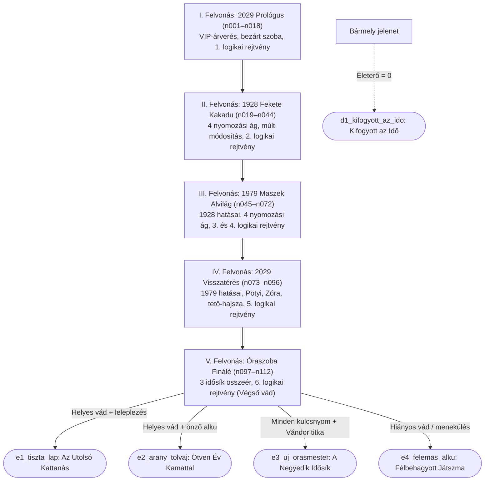

# A Háromszor Ellopott Óra – Világ- és történetterv (F1)

> **Állapot: JÓVÁHAGYVA (2026-11-28).** A felhasználó döntései (F1.1–F1.6) alapján készült. Ez a dokumentum a kaland (`adventures/haromszor-ellopott-ora/`) és minden további felvonás forrása.

## 0. Rögzített döntések (F1.1)

| Téma | Döntés |
| --- | --- |
| Műfaj | Kalandos, logikai feladványokkal és rejtélyekkel teli nyomozós történet, több idősíkban |
| Premissza | A) „A Háromszor Ellopott Óra” (Budapest, Kálmán-palota: 1928 / 1979 / 2029) |
| Hangnem | Könnyed, kalandos, szellemes |
| Célközönség / tartalom | 18+ korlátozás nélkül (nyers, sötét, felnőtt tartalom is megengedett) |
| Méret és játékidő | Hosszú kaland: 112 történeti csomópont (`n001`–`n112`) + 4 nem-halál befejezés + 1 motor-szintű halál-befejezés = 117 csomópont (~60–120 perc) |
| Nehézség | Normál (`2d6 ≤ tulajdonság + módosító`) |
| Karakterek | `characterMode: "both"` — 3 előre elkészített hős + saját karakter támogatása (`characterStatMap`-pel) |
| Szerencse | Próbázható, és minden Szerencse-próba után 1-gyel csökken (min. 0-ig) |
| Befejezések | 4 nem-halál befejezés (`victory`) + 1 motor-szintű halál-befejezés (`death`, 0 Életerő) |
| Logikai feladványok | 6 valódi játékos-logikai rejtvény + stat-próbák; hibás logikai válasznál valódi tét (sebzés/kerülőút), de nincs azonnali „insta-halál” |
| Kimenet | Beépített kaland az `adventures/haromszor-ellopott-ora/` mappában, kétnyelvűen (HU + EN), szövegesen először (képek később) |

---

## 1. Világ, tulajdonságok, hősök és szereplők (F1.2)

### Helyszín és alaprejtély
- **A helyszín:** A budapesti **Kálmán-palota** — patinás szecessziós bérpalota titkos pincelabirintussal, régi rácsos lifttel, tetőterasszal és a 4. emeleti, belülről reteszelhető **Óraszobával**.
- **A tárgy:** A **Kálmán-kronométer**, egy háromtárcsás arany-obszidián zsebóra, amely egy hatalmas örökség (és egy évszázados zsarolási archívum) kulcsa — egyben **időhorgony**, amellyel a játékos a palota három sorsfordító, pontosan 50 év különbséggel játszódó éjszakája között tud ugrálni:
  - **1928. november 11.** — füstös alagsori jazz-lokál (*Fekete Kakadu*), arisztokrata botrányok, pezsgő, pisztolylövés és az első bezárt szobás óralopás.
  - **1979. november 11.** — késő Kádár-kori maszek alvilág, valutázók, csempész-házibuli, kettős ügynökök és a második bezárt szobás eltűnés.
  - **2029. november 11.** — neonfényes budapesti VIP-galéria, maszkos kriptomilliárdosok, passzív-agresszív biztonsági MI és a harmadik lehetetlen lopás.
- **Az igazság (rejtett):** A három lopás nem három külön ügy, hanem egy idősíkokon átívelő összeesküvés és egy falba rejtett „időszéf” eredménye. Amit 1928-ban vagy 1979-ben megváltoztatsz, az a későbbi korszakokban átírja a nyomokat, kódokat és alibiket.
- **Hangnemi szabályok:** Pimasz, szellemes, pergő stílus; 1928-ban kabaré-irónia, 1979-ben pesti szleng (Béla tegez), 2029-ben Pötyi MI szigorúan udvarias magázással szúr oda.

### Tulajdonságok és `characterStatMap`
| Név | ID | Közös stat-pár | Mire próba |
| --- | --- | --- | --- |
| **Ész** | `esz` | `knowledge` | Logikai következtetés, rejtjelek, zármechanikák, nyomok összevetése |
| **Sárm** | `sarm` | `presence` | Blöff, duma, csábítás, kihallgatás, lekenyerezés |
| **Ügyesség** | `ugyesseg` | `agility` | Lopakodás, zsebtolvajlás, menekülés, gyors kéz |
| **Idegek** | `idegek` | `resolve` | Hidegvér, időugrás terhelése, verekedés/fájdalom, pia/méreg tűrése |
| **Szerencse** | `szerencse` | – | Vakmerő húzások, kártya, utolsó pillanatos mázli (**minden próba után −1**) |
| **Életerő** | `eletero` | – | Kötelező; `0`-nál azonnali motor-szintű halál-befejezés (`d1_kifogyott_az_ido`) |

### Előre készített hősök (`heroes.json`)
| Hős | ID | Szerep | Ész | Sárm | Ügy. | Idegek | Szer. | Élet | Képességkártya (egyszer használható) |
| --- | --- | --- | --- | --- | --- | --- | --- | --- | --- |
| **Szabó „Róka” Márk** | `roka_mark` | Biztosítási csalás-nyomozó | 9 | 8 | 7 | 7 | 8 | 14 | **„Egy apró részlet…”** (`apro_reszlet`): egy `esz` vagy `sarm` próba automatikus siker |
| **Varga Vera** | `varga_vera` | Műkincstolvaj és szabadulóművész | 7 | 8 | 10 | 6 | 9 | 13 | **„B-terv az ablakon át”** (`b_terv`): egy sikertelen `ugyesseg` vagy `szerencse` próba újradobása |
| **Dr. Kovács „Doki” Gábor** | `doki_gabor` | Éjszakai kórboncnok és kártyás | 8 | 6 | 7 | 10 | 8 | 16 | **„Két ujjnyi konyak”** (`ket_ujjnyi_konyak`): `+5 Életerő`, **vagy** egy `idegek` próba automatikus siker |

### Kulcsszereplők
- **1928:** **Várady „Vörös” Lola** (a *Fekete Kakadu* éles nyelvű dizőze, Kálmán Oszkár szeretője) · **Báró Székely Artúr** (cinikus ügyvéd, az alibik mestere) · **Kálmán Oszkár** (a meggyilkolt óragyűjtő mágnás).
- **1979:** **„Szotyis” Béla** (maszek valutázó és házmester-mindenes, tegez) · **Kardos Ilona** (hűvös, csábító kettős ügynök, profi blöffölő).
- **2029:** **Kálmán Zóra** (a palota dekadens, gátlástalan örököse) · **P-07 „Pötyi”** (passzív-agresszív, magázó biztonsági MI).
- **Mindhárom korszakban:** **A Vándor / Órásinas** — 1928-ban hallgatag inas, 1979-ben pincei órás, 2029-ben maszkos licitáló.

### Vizuális téma (`theme`)
- `background`: `#151118`, `surface`: `#231c27`, `accent`: `#e4b363`, `text`: `#f4ede2`, `font`: `serif`.

---

## 2. Történetgráf és 5 felvonás (F1.3)

**112 történeti csomópont (`n001`–`n112`) + 5 befejezés (`e1`–`e4`, `d1`) = 117 csomópont.**

### Felvonások és a 6 logikai feladvány
1. **I. Felvonás – A Harmadik Lopás (2029, `n001`–`n018`, 18 jelenet):** VIP-aukció, Pötyi MI, éjféli áramszünet, bezárt Óraszoba, *1. Logikai feladvány: A Bezárt Szoba Paradoxona*, első időugrás 1928-ba.
2. **II. Felvonás – Pezsgő, Füst és Pisztolylövés (1928, `n019`–`n044`, 26 jelenet):** *Fekete Kakadu* lokál, 4 ág (Lola öltözője, Báró Székely kártyaszobája, Pincei kazánház/Órásinas + múlt-módosítás, Éjféli lövés), *2. Logikai feladvány: A Három Pezsgősüveg és a 23:54-es Zsebóra*.
3. **III. Felvonás – Farmer, Valuta és Kémtükör (1979, `n045`–`n072`, 28 jelenet):** 1928 hatásai (elrejtett rézkulcs, megkarcolt órafedél), 4 ág (Béla valutázó-bulija, Kardos Ilona lehallgatófülkéje, Órásműhely + 2029-es riasztó szabotálása, Csempész-aukció), *3. Logikai feladvány: A Három Fogaskerék-tárcsa*, *4. Logikai feladvány: A Magnetofonszalag-vágás*.
4. **IV. Felvonás – A Kétirányú Hurok (2029, `n073`–`n096`, 24 jelenet):** 1979 hatásai, Pötyi szerverszobája, Kálmán Zóra magánlakosztálya, Tetőterasz-hajsza idővillanásokkal, *5. Logikai feladvány: A Három Korszak Kombinációja (Időszéf)*.
5. **V. Felvonás – A Nagy Leleplezés az Óraszobában (Finálé, `n097`–`n112`, 16 jelenet):** Mindhárom idősík összeér, *6. Logikai feladvány: A Végső Vád (3 lépcsős kihallgatás: tettes, módszer, a Vándor kiléte)* → `e1`–`e4`.

### Befejezések (4 nem-halál + 1 halál)
- `e1_tiszta_lap` (**Az Utolsó Kattanás**, `victory`): Leleplezés és az időhurok lezárása.
- `e2_arany_tolvaj` (**Ötven Év Kamattal**, `victory`): Pimasz meglépés az örökséggel/órával.
- `e3_uj_orasmester` (**A Negyedik Idősík**, `victory`): Titkos befejezés mindhárom korszak kulcsnyomával és a Vándor naplójával.
- `e4_felemas_alku` (**Félbehagyott Játszma**, `victory`): Keserédes menekülés hiányos bizonyítékkal.
- `d1_kifogyott_az_ido` (**Kifogyott az Idő**, `death`, `deathEndingId`): 0 Életerő bárhol.

---

## 3. Állapotterv (F1.4)

### Tárgyak (`items.json` – 10 db)
| Tárgy | ID | Felvonás | Szerep / módosító |
| --- | --- | --- | --- |
| **Törött Óralánc** | `torott_oralanc` | I. (2029) | `+1 Idegek` (`n017_elso_idougras` és finálé); az időugrás horgonya |
| **Parfümös Levél** | `parfumos_level` | II. (1928) | `+1 Sárm` Zóra szembesítésénél; alibi-bizonyíték |
| **Sárgaréz Szellőzőkulcs** | `rezkulcs_1928` | II. (1928) | Ha elrejted 1928-ban (`key_hidden_1928`), 1979-ben kinyitja a lomtárat |
| **1928-as Hangvilla-kulcs** | `hangvilla_kulcs` | II. (1928) | `+1 Ész` a 3. és 5. rejtvénynél; kulcsnyom `e3`-hoz |
| **Csempész-alaprajz** | `csempesz_terkep` | III. (1979) | `+1 Ügyesség` a 2029-es tetőterasz-hajszában |
| **Kém-magnetofonszalag** | `magnetofon_szalag` | III. (1979) | Hangbizonyíték és a 4. rejtvény kulcsa |
| **Órás Foszforpor** | `foszforpor` | III. (1979) | `+2 Ügyesség` Pötyi lézerhálójánál |
| **Biometrikus VIP-kártya** | `biometrikus_kartya` | IV. (2029) | Nyitja Zóra páncélszekrényét és a szervizajtót |
| **100 Éves Zsarolási Akta** | `zsarolasi_akta` | IV. (2029) | Fő bizonyíték `e1`-hez és `e2`-höz |
| **A Vándor Zsebnaplója** | `vandor_naploja` | IV. (2029) | Felfedi a Vándor kilétét; feltétel `e3`-hoz |

### Pillangóhatás- és fő flagek
- **Korszakok közötti hatások:** `key_hidden_1928`, `watch_marked_1928`, `alarm_sabotaged_1979`, `note_left_1979`.
- **Rejtvény- és kódrészletek:** `solved_puzzle_1_lock`, `code_part_1`, `code_part_2`, `solved_puzzle_4_tape`, `code_part_3`, `solved_puzzle_5_vault`, `verdict_killer_right`, `verdict_method_right`, `verdict_wanderer_right`.
- **Szövetségesek és állapot:** `potyi_friendly`, `lola_ally`, `bela_ally`, `ilona_deal`, `zora_deal`.
- **Holtpont-garancia:** Minden hubban legalább egy feltétel nélküli továbblépési választás van; a hibás logikai válaszok sebzést vagy kerülőutat adnak, de soha nem zárják el a kijáratot.

---

## 4. Nehézségi és életerő-balansz (F1.5)

- `P(2d6 ≤ n)`: `6 → 42%`, `7 → 58%`, `8 → 72%`, `9 → 83%`, `10 → 92%`.
- A 3 hős eltérő optimális útvonalat kap (Márk: ész/sárm; Vera: ügyesség/szerencse, de alacsony idegek; Doki: idegek/életerő, de alacsony sárm).
- Sebzés: `−2 / −3 / −4` Életerő; felvonásonként 1 tematikus gyógyulás (`+3 Életerő`), valamint Doki kártyája (`+5`).
- Szerencse-próbák: 5 kulcspillanatban (1928 póker, 1979 razzia, 2029 lézerugrás, Időszéf-vakszerencse, Finálé), próbánként `−1` Szerencse.
