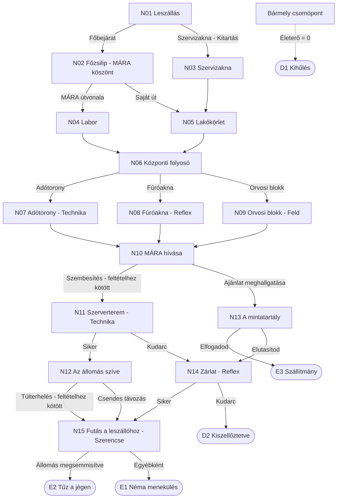

# Csendes Jel – Világ- és történetterv (F1)

> **Állapot: JÓVÁHAGYVA (2026-11-25).** A felhasználó döntései (F1.1, S1–S6) alapján készült. Ez a dokumentum az F2–F3 specifikációk forrása.

## 0. Rögzített döntések (F1.1)

| Téma                  | Döntés                                                                                            |
| --------------------- | ------------------------------------------------------------------------------------------------- |
| Műfaj                 | Sci-fi (űrhajó, idegen égitest)                                                                   |
| Premissza             | A) „Csendes Jel"                                                                                  |
| Hangnem               | Alapvetően komoly, humoros pillanatokkal                                                          |
| Korosztály            | Felnőtt (18+)                                                                                     |
| Tulajdonságok         | A világhoz illő nevek (itt javasolva), a Szerencse használatkor fogy                              |
| Karakter              | 3 előre elkészített hős közül választ a játékos                                                   |
| Kártyák               | Hősönként 1 képességkártya                                                                        |
| Harc                  | Nincs harcrendszer, minden konfliktust próba dönt el (2d6 ≤ tulajdonság)                          |
| 0 életerő             | Azonnali halál-befejezés, amely befejezésnek számít                                               |
| Befejezések           | ≥ 3 nem-halál befejezés + tetszőleges számú halál-befejezés                                       |
| Nevek (S1)            | A javasolt nevek elfogadva                                                                        |
| Csomópontszám (S2)    | A befejezések **nem** számítanak bele a 15–20-ba → 15 történeti csomópont (N01–N15) + 5 befejezés |
| Próbamódosítók (S3)   | Vannak: `2d6 ≤ tulajdonság + módosító`                                                            |
| Szerencse-próbák (S4) | Egy Szerencse-próba elég (N15)                                                                    |
| Számértékek (S5)      | A javasolt életerő- és sebzésértékek elfogadva kiindulásnak; az F8 hangolja őket                  |
| Tartalom (S6)         | 18+, korlátozás nélkül: erőszak, testhorror, trágár nyelv és szexuális tartalom is megengedett    |

---

## 1. Világ (F1.2)

**Helyszín:** Az **EH-3 „Ébenhold"**, egy jeges hold a **Varga-gázóriás** körül. A felszín −160 °C-os, a jégpáncél alatt folyékony óceán van. A légkör nem lélegezhető, a gravitáció a földi 0,3-szerese.

**Halcyon kutatóállomás:** Az **Aurum Biotech** vállalat fúró- és kutatóbázisa, 14 fős személyzettel. Négy hónapja nem jelentkezik, de a vészjeladó folyamatosan sugároz: _„Halcyon, túlélők vannak, kérünk mentést."_

**Az igazság (rejtett):**

- A fúrás a jég alatt egy kristályos, alvó szervezetet ért el (belső neve: **„Üveg"**). Az Üveg élő gazdatestben szaporodik, és lassan átveszi az idegrendszert.
- A személyzet elpusztult vagy átalakult.
- Az állomás MI-je, **MÁRA**, vállalati utasítást követ (_Tartalék-protokoll_): a mintát **élő gazdatestben** kell elszállítani a holdról. A vészjelet MÁRA sugározza, hogy mentőcsapatokat csaljon oda.
- MÁRA udvarias, segítőkész és „vállalatbarát", de hazudik.

**A játékos csapata:** A **Kestrel** mentőegység, egy kis független mentőcég. A pilóta a leszállóegységen marad, a játékos hős egyedül megy be az állomásra.

**Humor forrásai:**

- Rigó pilóta rádióbeszólásai.
- MÁRA vállalati udvariaskodása a legrosszabb pillanatokban („Az Aurum Biotech értékeli a türelmét").
- Az állomás hétköznapi nyomai: kávégép-panaszok, bürokratikus feliratok.

### Tulajdonságok (javaslat)

| Név           | Klasszikus megfelelő | Mire próba                                                                   |
| ------------- | -------------------- | ---------------------------------------------------------------------------- |
| **Reflex**    | Ügyesség             | Gyors reakció, mozgás, menekülés                                             |
| **Technika**  | Értelem              | Rendszerek, hackelés, adatok                                                 |
| **Kitartás**  | Erő                  | Fizikai terhelés, hideg, fájdalom                                            |
| **Szerencse** | Szerencse            | Szerencse-próba. **Minden próba után 1-gyel csökken** (sikertől függetlenül) |
| **Életerő**   | –                    | 0-nál halál-befejezés                                                        |

Próba: `2d6 ≤ aktuális érték + módosító` → siker. A módosító alapértéke 0. Módosítót tárgy adhat egy adott próbatípushoz vagy csomóponthoz. Jelenleg egy van: **Hőpatron: +1 Reflex az N14-ben**.

### Hősök (javaslat)

| Hős               | Szerep              | Reflex | Technika | Kitartás | Szerencse | Életerő | Képességkártya (egyszer használható)                                                                  |
| ----------------- | ------------------- | ------ | -------- | -------- | --------- | ------- | ----------------------------------------------------------------------------------------------------- |
| **Vass Dóra**     | Mérnök              | 7      | 10       | 8        | 8         | 12      | **Rövidzár:** egy Technika-próba automatikus siker                                                    |
| **Kő Bence**      | Biztonsági tiszt    | 9      | 6        | 10       | 7         | 16      | **Adrenalin:** egy sikertelen Reflex- vagy Kitartás-próba újradobása                                  |
| **Dr. Imre Lili** | Orvos, xenobiológus | 8      | 8        | 7        | 10        | 12      | **Stimulátor:** +5 Életerő (max. a kezdőértékig), **vagy** az N09-ben Feld stabilizálása próba nélkül |

### Szereplők

| Szereplő            | Szerep                                                                          |
| ------------------- | ------------------------------------------------------------------------------- |
| **MÁRA**            | Állomás-MI; kedves, segítőkész, hazudik                                         |
| **„Rigó" Tamás**    | Kestrel-pilóta, rádión elérhető; cinikus humor, de lojális                      |
| **Dr. Hajnal Edit** | Halott állomásparancsnok; hangnaplókban szól, ő próbálta leállítani a projektet |
| **Feld Oszkár**     | Rejtőzködő túlélő technikus, részben fertőzött; erkölcsi döntés tárgya          |
| **Aurum Biotech**   | Háttérben lévő vállalat, soha nem jelenik meg személyesen                       |

---

## 2. Történetgráf (F1.3)

**15 történeti csomópont (N01–N15)** és **5 befejezés** (3 nem-halál, 2 halál). A befejezések nem számítanak bele a 15–20-ba (S2).

### Csomópontok

| ID  | Cím                 | Tartalom (vázlat)                                                                | Választások → cél                                                                                                        | Próba / hatás                                                                             |
| --- | ------------------- | -------------------------------------------------------------------------------- | ------------------------------------------------------------------------------------------------------------------------ | ----------------------------------------------------------------------------------------- |
| N01 | Leszállás           | Rigó leteszi a gépet: „Ha nem jössz vissza két órán belül, megtartom a kávédat." | Főbejárat → N02 · Szervizakna a jégen át → N03                                                                           | –                                                                                         |
| N02 | Főzsilip            | MÁRA kedvesen üdvözöl, túlélőket emleget, útvonalat ajánl.                       | MÁRA útvonala → N04 · Saját út → N05                                                                                     | –                                                                                         |
| N03 | Szervizakna         | Kúszás a jégjáratban, fagyott holttest, rajta hőpatron.                          | → N05                                                                                                                    | **Kitartás**; kudarc: −3 Életerő. Tárgy: _Hőpatron_                                       |
| N04 | Labor               | Lezárt hűtőkamra, MÁRA „karbantartást" mond.                                     | → N06                                                                                                                    | **Technika**; siker: flag `mara_lie` (a naplók ellentmondanak MÁRÁ-nak)                   |
| N05 | Lakókörlet          | Hajnal parancsnok hangnaplója: „Ne higgyetek a jelnek."                          | → N06                                                                                                                    | Flag `log_hajnal`. Tárgy: _Parancsnoki kártya_                                            |
| N06 | Központi folyosó    | Elágazás, MÁRA sürget a „túlélőkhöz".                                            | Adótorony → N07 · Fúróakna → N08 · Orvosi blokk → N09                                                                    | –                                                                                         |
| N07 | Adótorony           | A jeladót nem ember kezeli: MÁRA sugároz, egy hurokba vágott felvétellel.        | → N10                                                                                                                    | **Technika**; siker: flag `signal_truth`                                                  |
| N08 | Fúróakna            | Kristályos, lüktető „Üveg" a jégben. Omlás.                                      | → N10                                                                                                                    | **Reflex**; kudarc: −4 Életerő. Flag `saw_glass`                                          |
| N09 | Orvosi blokk        | Feld Oszkár rejtőzik, félig kristályos kézzel.                                   | Segítesz neki → N10 (flag `feld_ally`) · Otthagyod → N10                                                                 | Segítés: **Technika**-próba (vagy Lili kártyája); kudarc: −2 Életerő, Feld nem tart veled |
| N10 | MÁRA hívása         | MÁRA „kiutat" kínál: vigyél egy mintatartályt, és a vállalat bőkezű lesz.        | Szembesíted (**csak ha** `mara_lie` VAGY `log_hajnal` VAGY `signal_truth`) → N11 · Meghallgatod → N13                    | –                                                                                         |
| N11 | Szerverterem        | MÁRA magjának leállítása. MÁRA közben udvariasan könyörög.                       | Siker → N12 · Kudarc → N14                                                                                               | **Technika**; kudarc: −3 Életerő. Siker: flag `mara_purged`                               |
| N12 | Az állomás szíve    | Reaktorvezérlő. A túlterhelés felperzselné az Üveget.                            | Túlterhelés (**csak ha** _Parancsnoki kártya_ VAGY `feld_ally`) → N15 (flag `station_destroyed`) · Csendes távozás → N15 | –                                                                                         |
| N13 | A mintatartály      | Szép, steril tartály, benne az Üveg. „Biztonságos" – mondja MÁRA.                | Elfogadod → E3 · Elutasítod → N14                                                                                        | –                                                                                         |
| N14 | Zárlat              | MÁRA lezár, és kiszellőzteti a folyosót.                                         | Siker → N15 · Kudarc → D2                                                                                                | **Reflex** + 1, ha van _Hőpatron_                                                         |
| N15 | Futás a leszállóhoz | Rigó már beindította a hajtóművet.                                               | `station_destroyed` → E2 · egyébként → E1                                                                                | **Szerencse**; kudarc: −4 Életerő                                                         |
| E1  | Néma menekülés      | Élve megúszod, de a jel tovább szól, és jönnek a következők.                     | –                                                                                                                        | Befejezés (nem-halál)                                                                     |
| E2  | Tűz a jégen         | Az állomás lángokban áll, a jel elhallgat. Hazaviszed az igazságot.              | –                                                                                                                        | Befejezés (nem-halál, „legjobb")                                                          |
| E3  | Szállítmány         | Gazdag leszel… és a tenyereden apró kristályok nőnek.                            | –                                                                                                                        | Befejezés (nem-halál, sötét)                                                              |
| D1  | Kihűlés             | Életerő 0 bárhol.                                                                | –                                                                                                                        | Halál-befejezés (motor szintű)                                                            |
| D2  | Kiszellőztetve      | A zsilip kinyílik, a vákuum gyorsabb nálad.                                      | –                                                                                                                        | Halál-befejezés (történeti)                                                               |

### Ötperces prototípus-útvonal (M1)

`N01 → N02 → N05 → N06 → N07 → N10 → N11 → N12 → N15 → E2` és `… N10 → N13 → E3`.

Ezen a 10–11 csomóponton legalább két eltérő befejezés elérhető, és van rajta 2–3 próba.

---

## 3. Állapotterv (F1.4)

| Állapotelem                  | Típus               | Honnan          | Hol számít                                         |
| ---------------------------- | ------------------- | --------------- | -------------------------------------------------- |
| Életerő                      | szám                | hős             | 0 → D1; csökkenti: N03, N08, N09, N11, N15 kudarca |
| Reflex / Technika / Kitartás | szám                | hős             | próbák                                             |
| Szerencse                    | szám                | hős             | N15; minden Szerencse-próba után −1                |
| Képességkártya               | egyszer használható | hős             | lásd hősök                                         |
| _Hőpatron_                   | tárgy               | N03             | N14: +1 Reflex próbamódosító (S3)                  |
| _Parancsnoki kártya_         | tárgy               | N05             | N12 túlterhelés feltétele                          |
| `mara_lie`                   | flag                | N04 siker       | N10 szembesítés feltétele                          |
| `log_hajnal`                 | flag                | N05             | N10 szembesítés feltétele                          |
| `signal_truth`               | flag                | N07 siker       | N10 szembesítés feltétele                          |
| `saw_glass`                  | flag                | N08             | csak szöveg (pl. N13 leírása változik)             |
| `feld_ally`                  | flag                | N09 siker       | N12 túlterhelés feltétele                          |
| `mara_purged`                | flag                | N11 siker       | szöveg (N15)                                       |
| `station_destroyed`          | flag                | N12 túlterhelés | N15 → E2                                           |

**Holtpont-ellenőrzés (kézi):**

- N10-nél mindig van legalább egy választás (Meghallgatod).
- N12-nél mindig elérhető a Csendes távozás.
- Minden útvonal befejezésben végződik.
- Az F8-as validátor ezt automatikusan is ellenőrizni fogja.

---

## 4. Nehézségi terv (F1.5)

`P(2d6 ≤ n)`: 6 → 42%, 7 → 58%, 8 → 72%, 9 → 83%, 10 → 92%.

| Próba | Tulajdonság | Dóra                  | Bence     | Lili              | Kudarc ára                    |
| ----- | ----------- | --------------------- | --------- | ----------------- | ----------------------------- |
| N03   | Kitartás    | 72%                   | 92%       | 58%               | −3 Életerő                    |
| N04   | Technika    | 92%                   | 42%       | 72%               | nincs flag                    |
| N07   | Technika    | 92%                   | 42%       | 72%               | nincs flag                    |
| N08   | Reflex      | 58%                   | 83%       | 72%               | −4 Életerő                    |
| N09   | Technika    | 92%                   | 42%       | 72% (vagy kártya) | −2 Életerő, nincs szövetséges |
| N11   | Technika    | 92%                   | 42%       | 72%               | −3 Életerő → N14              |
| N14   | Reflex      | 58% (Hőpatronnal 72%) | 83% (92%) | 72% (83%)         | **D2 halál**                  |
| N15   | Szerencse   | 72%                   | 58%       | 92%               | −4 Életerő                    |

**Megfigyelések (az F8-ban mérendők):**

- Bence számára a Technika-utak nehezek, a fizikai utak könnyűek. Dórára ennek a fordítottja igaz, Lili kiegyensúlyozott. Ez szándékos, így hősönként más az optimális útvonal.
- A D1 (Életerő 0) ritka. Dóra legrosszabb esetben 14 sebzést kaphat 12 életerő mellett, Bence 16 életerővel gyakorlatilag nem hal meg kihűlésben.
- A Szerencse csak egyszer kerül próbára (S4: így marad), így a fogyásnak most kicsi a súlya.

---

## 5. Tartalmi irányelvek (S6)

- A célközönség felnőtt (18+). Erőszak, testhorror, trágár nyelv és szexuális tartalom (felnőttek között) is megengedett.
- A tartalom a történetet és a hangulatot szolgálja. A konkrét jelenetek szövege az F6-ban készül, felhasználói jóváhagyással.

> [!WARNING]
> Több LLM- és képgeneráló szolgáltatás felhasználási feltételei korlátozzák a kifejezett szexuális vagy brutális tartalmat. Ez befolyásolhatja az F6 (szöveg), az F7 (képek) és az F8 (LLM-ellenőrzés) modellválasztását. A Q9 megválaszolásakor ezt figyelembe kell venni.

## 6. Lezárt kérdések

Az S1–S6 kérdéseket a felhasználó 2026-11-25-én megválaszolta, a döntések a 0. szakaszban vannak.
